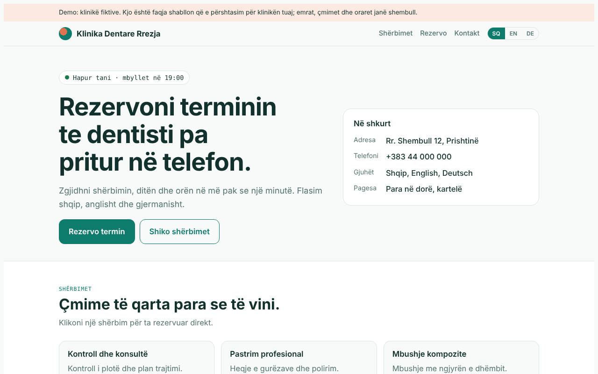
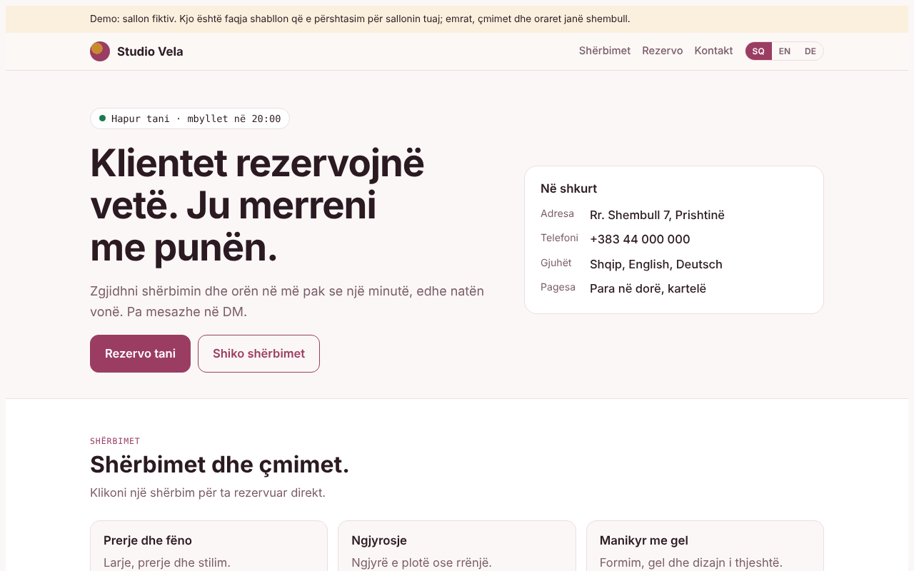
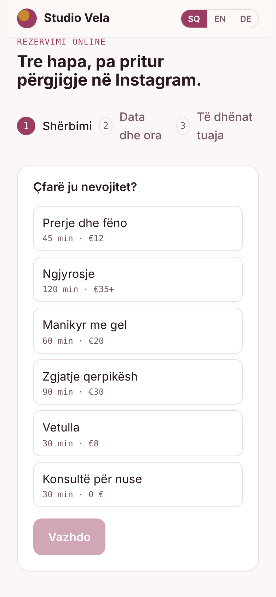

# Booking Site Templates

One-page websites with **online booking** for small local businesses (clinics and salons), in
**Albanian, English and German**. I use them in my small web studio: each client gets their own
`config.json`, and a build script turns it into a ready-to-host site.

| Desktop | Booking flow on mobile |
|---|---|
|  |  |
|  |  |

**Stack:** HTML · CSS · vanilla JavaScript · PowerShell build script · Cloudflare Pages

## Features

- **3-step booking:** service → day and time → name, phone and consent. Free slots come from the opening hours and service length.
- **Booking requests over WhatsApp:** the finished request opens WhatsApp with the details filled in, so the business confirms it in the app they already use.
- **Three languages** (SQ / EN / DE) with a language switch, for local customers and the diaspora.
- **Live open/closed status** based on the business's opening hours and time zone.
- **Privacy notice** with a data-retention period set per client.
- **No framework, no dependencies:** each site is a single HTML file that loads fast on phones.
- **Demo mode:** demo sites show a banner and never send real requests.

## How it works

```
clients/<client>/config.json  ──►  build.ps1  ──►  dist/<client>/index.html + _headers
          (name, hours, services,         (validates the config,       (upload to Cloudflare Pages)
           prices, team, languages)        injects it into a template)
```

`build.ps1` checks every config before building: required fields, opening hours in the right format,
unique service ids, all three languages filled in, and, for live sites, a real WhatsApp number and no
leftover example data. Errors are listed in plain language so nothing broken gets published.

The two demo clients in `clients/` (a fictional dental clinic and a fictional salon) show the format.

## Build and preview (Windows)

```bat
build.cmd                 :: build every client in clients\
build.cmd demo-klinika    :: build one client
serve.cmd                 :: preview dist\ at http://localhost:8787/
```

Both scripts run on the Windows PowerShell 5.1 that ships with Windows, with nothing to install.

## Add a client

1. Copy `clients/demo-klinika` (or `demo-salon`) to `clients/<new-client>`.
2. Edit `config.json`: name, address, phone, WhatsApp number, opening hours, services, prices and team. Set `"demo": false`.
3. Run `build.cmd <new-client>` and upload `dist/<new-client>/` to Cloudflare Pages.
